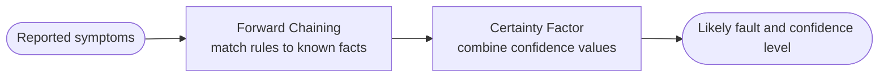
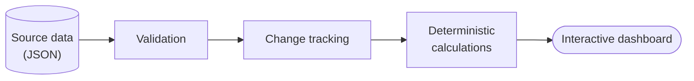

<!--
CATATAN SETUP (hapus komentar ini setelah selesai)
1. Buat repository PUBLIC dengan nama persis sama dengan username GitHub Anda.
2. Upload README.md dan folder assets/ (banner.svg, footer.svg) ke root repository.
3. Ganti USERNAME, YOUR_LINKEDIN_URL, dan YOUR_EMAIL_ADDRESS.
4. Setelah repository proyek bersifat publik, buka komentar "View repository" pada proyek terkait.
5. Jika halaman web portofolio sudah aktif di GitHub Pages, buka juga komentar badge Portfolio di bawah.
-->

  

<!--  -->

  

**[About](#about) · [Skills](#skills) · [Projects](#projects) · [Contact](#contact)**

---

## About

I'm an Information Systems graduate who enjoys turning practical problems into structured solutions through software, data, and technology. My background combines academic software development with hands-on technical work, including troubleshooting internet connectivity and network devices.

I've worked on an expert system for diagnosing IndiHome service issues and am currently developing a dashboard for exploring global macroeconomic and market data. I like understanding how systems work, documenting what I build, and improving solutions through practical testing.

<table>
  <tr>
    <td width="33%" valign="top">
      <h4>💻 Software Development</h4>
      Building practical applications and documenting their design.
    </td>
    <td width="33%" valign="top">
      <h4>📊 Data Analytics</h4>
      Preparing, exploring, and presenting structured data.
    </td>
    <td width="33%" valign="top">
      <h4>🛠️ Technical Systems</h4>
      Linux, computer networks, connectivity, and troubleshooting.
    </td>
  </tr>
</table>

## Skills

  
  
  
  
  

**Methods & concepts:** Forward Chaining · Certainty Factor · Prototype Model · Data Processing · JSON · IPv4/IPv6 Networking

## Projects

### 1. IndiHome Service Fault Diagnosis Expert System

An expert system designed to help diagnose IndiHome service issues during the 60-day post-installation retention period.

| | |
|---|---|
| **Approach** | Forward Chaining and Certainty Factor |
| **Visualization** | Decision-tree representation of diagnostic rules |
| **Stack** | PHP Native, MySQL |
| **Development method** | Prototype Model |

<b>See the simplified diagnostic flow</b>

<!-- [View repository →](ADD_REPOSITORY_URL) -->

### 2. Global Macro & Market Intelligence Dashboard

An ongoing project to organize and explore global macroeconomic and market information through a structured, interactive dashboard.

| | |
|---|---|
| **Focus** | Structured JSON data, data validation, change tracking, and visual exploration |
| **Design principle** | Deterministic and explainable calculations, with source data kept inspectable |

<b>See the simplified data flow</b>

<!-- [View repository →](ADD_REPOSITORY_URL) -->

### 3. Technical Labs: Linux & Networking

Practical notes and experiments on Linux server administration, OpenWrt, network configuration, and connectivity troubleshooting.

<!-- [View repository →](ADD_REPOSITORY_URL) -->

## Contact

I'm open to opportunities in software development, data analytics, and technical systems. Feel free to reach out via [LinkedIn](YOUR_LINKEDIN_URL) or [email](mailto:YOUR_EMAIL_ADDRESS).

*Always learning, building, and documenting.*

