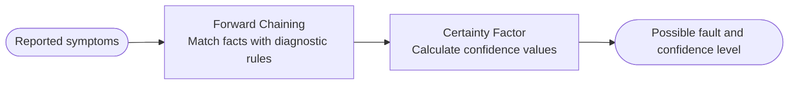
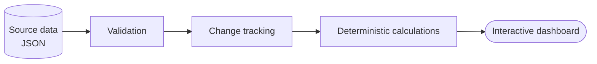

<!--
PROFILE README SETUP
1. Use this file as README.md in the public repository named exactly: gapuma.
2. Upload assets/banner.svg and assets/footer.svg to the repository.
3. Replace YOUR_LINKEDIN_URL and YOUR_EMAIL_ADDRESS with your real links.
4. Add your university name and graduation year under Education.
5. Add project repository links only after those repositories are ready to be public.
-->

  

  

**[About](#about) · [Experience](#professional-experience) · [Skills](#skills) · [Projects](#projects) · [Education](#education) · [Contact](#contact)**

---

## About

I am an Information Systems graduate interested in software development, data analytics, and technical systems. My experience combines hands-on work in telecommunications with academic software development and independent technical projects.

In my previous role as an IndiHome installation technician at PT Mutiara Sentosa, an IndiHome partner of PT Telkom Indonesia, I handled new customer installations and follow-up technical issues during the post-installation retention period. This experience helped me understand service operations, network equipment, and the importance of systematic troubleshooting.

For my undergraduate thesis, I designed an expert system to support the diagnosis of IndiHome service issues during the 60-day post-installation retention period. I am also developing a Global Macro & Market Intelligence Dashboard to organize and explore macroeconomic and market data.

I value practical problem-solving, clear documentation, and solutions whose processes and results can be inspected.

## Professional Experience

### IndiHome New Installation Technician (PSB)

**PT Mutiara Sentosa** — IndiHome partner of PT Telkom Indonesia  
Bekasi, Indonesia

- Performed on-site installations of new IndiHome services for customers.
- Handled follow-up complaints and technical issues during the post-installation retention period.
- Troubleshot internet and service connectivity issues by checking relevant network and customer-premises equipment, including ODP, ONT/ONU, STB, and in-home cabling.
- Investigated reported issues such as loss of internet connectivity, abnormal ONT/ONU indicator conditions, slow connections, and service interruptions.
- Communicated technical findings and performed corrective actions based on the issue identified in the field.

## Skills

### Software Development & Data

  
  
  
  

### Systems & Networking

  
  
  

**Methods & concepts:** Forward Chaining · Certainty Factor · Prototype Model · Data Processing · Data Validation · IPv4/IPv6 Networking · Network Troubleshooting

*The technologies and concepts above reflect tools and methods used or explored in my academic, work, and personal technical activities. Project-specific details are described in each project section.*

## Projects

### 1. IndiHome Service Fault Diagnosis Expert System

**Undergraduate thesis project** — *Perancangan Sistem Pakar untuk Diagnosis Gangguan Layanan IndiHome dengan Metode Forward Chaining dan Certainty Factor pada Masa Retensi 60 Hari Pascapemasangan.*

Designed an expert system to support the diagnosis of IndiHome service issues reported during the 60-day post-installation retention period. The project applies rule-based inference and certainty values to help determine possible causes from reported symptoms.

| | |
|---|---|
| **Inference method** | Forward Chaining |
| **Uncertainty handling** | Certainty Factor |
| **Rule representation** | Decision-tree visualization |
| **Technology stack** | PHP Native, MySQL |
| **Development method** | Prototype Model |
| **Research activities** | Interviews and analysis of service-issue cases |

<b>See the simplified diagnostic flow</b>

<!-- Add the repository URL when the project repository is public:
[View repository →](YOUR_EXPERT_SYSTEM_REPOSITORY_URL)
-->

### 2. Global Macro & Market Intelligence Dashboard

An independent project in development to organize and explore global macroeconomic and market information through a structured, interactive dashboard.

The project emphasizes inspectable source data and deterministic calculations rather than opaque, AI-generated conclusions. Its design focuses on helping users review data, identify changes between snapshots, and explore market information in a consistent interface.

| | |
|---|---|
| **Data format** | Structured JSON |
| **Focus** | Data validation, snapshot comparison, and visual exploration |
| **Design principle** | Deterministic, explainable calculations and inspectable source data |
| **Planned capabilities** | Change tracking, watchlists, timeline views, and report export |

<b>See the simplified data flow</b>

<!-- Add the repository URL when the project repository is public:
[View repository →](YOUR_MACRO_DASHBOARD_REPOSITORY_URL)
-->

### 3. Linux & Networking Practice

A collection of hands-on learning and experiments related to Linux server administration, OpenWrt configuration, and computer networking.

Topics explored include:

- Linux server installation, command-line administration, SSH, and service management.
- OpenWrt network configuration and troubleshooting.
- IPv4/IPv6 connectivity and network diagnostics.
- Basic service deployment and remote access for self-hosted applications.

<!-- Add a repository URL when notes and examples are ready to publish:
[View repository →](YOUR_LINUX_NETWORKING_REPOSITORY_URL)
-->

## Education

**Bachelor's Degree in Information Systems**  
<!-- Add your university name and graduation year here when ready. -->

## Contact

I am open to opportunities related to software development, data analytics, and technical systems. You can reach me through [LinkedIn](YOUR_LINKEDIN_URL) or [email](mailto:YOUR_EMAIL_ADDRESS).

*Always learning, building, and documenting.*

